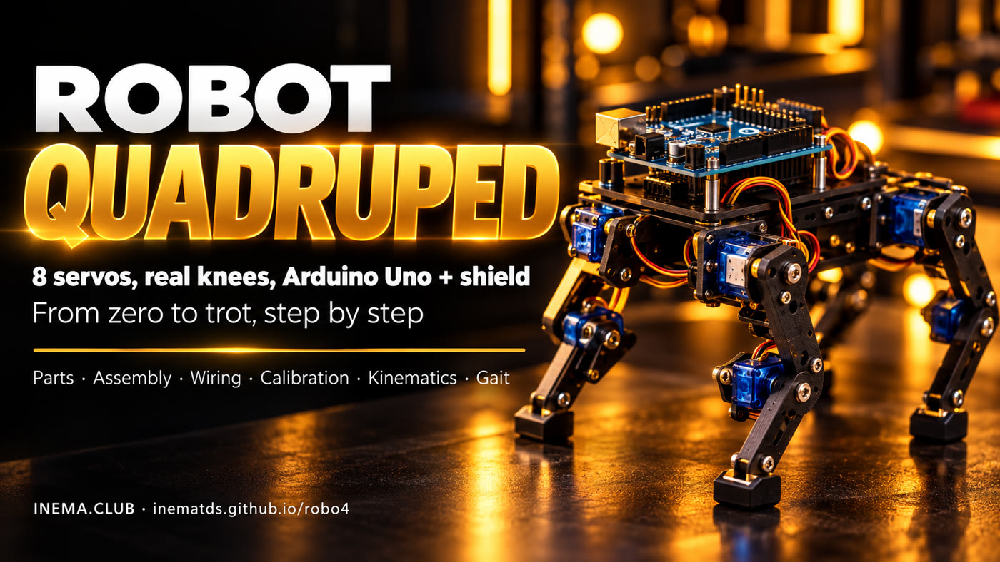

# robo4 — quadruped robot with knees

**🇧🇷 [Português](README.md) · 🇺🇸 [English](README.en.md) · 🇪🇸 [Español](README.es.md)**

## What it is

robo4 is a complete plan for building a small, walking quadruped robot at home (about 20 cm tall). Each leg has two servos: one at the hip and one at the knee, for a total of 8. An Arduino Uno controls everything, with a Sensor Shield V5 mounted on top and the servos plugged into it. The repository includes the parts list, wiring diagrams, step-by-step assembly and calibration instructions, and code that already compiles for the Uno.

## 📖 User guide

Complete guide (landing page + step-by-step instructions): **https://inematds.github.io/robo4/guia/en/**

Detailed plan (decisions, parts, pins, common issues): [PLANO.md](PLANO.md) (in Portuguese)

## What’s here

| Path | Contents |
|---|---|
| `PLANO.md` | Complete build plan |
| `firmware/montagem/` | Sketch that sets all 8 servos to 90° for attaching the legs |
| `firmware/robo4/` | Firmware: inverse kinematics, trot, slow walk, turning, EEPROM calibration |
| `guia/assets/diagrama-*.svg` | Diagrams: wiring, pins, leg geometry, calibration, gait (PT, `-en`, `-es`) |
| `guia/assets/*.jpg` | AI-generated illustrations (kit, exploded view, leg, wiring, assembled robot) |
| `guia/` | Guide page in PT, `guia/en/`, and `guia/es/` |

## Hardware at a glance

Arduino Uno + Sensor Shield V5 · 8× MG90S on pins D2–D9 · 2S LiPo → UBEC 6 V/5 A on the servo terminal block (SEL jumper removed) · LiPo on the Uno’s VIN · Common GND.

## The process, from start to finish

Legend: 🧠 you (with Nei) · ⚙️ command/script · 🤖 `claude -p`

| # | Step | Command | Who |
|---|---|---|---|
| 1 | Buy the parts on the list and charge the LiPo | [PLANO.md › Parts list](PLANO.md#2-lista-de-peças) (in Portuguese) | 🧠 |
| 2 | Install the Uno compiler | `arduino-cli core install arduino:avr && arduino-cli lib install Servo` | ⚙️ |
| 3 | Measure the UBEC output (5–6 V) before connecting a servo | multimeter | 🧠 |
| 4 | Shield on the Uno, SEL jumper removed, UBEC on the terminal block, LiPo on VIN | [wiring diagram](guia/assets/diagrama-fiacao-en.svg) | 🧠 |
| 5 | Set all 8 servos to 90° | `arduino-cli compile --fqbn arduino:avr:uno firmware/montagem && arduino-cli upload -p /dev/ttyACM0 --fqbn arduino:avr:uno firmware/montagem` | ⚙️ |
| 5b | Cut or print the parts | [dimensioned drawing](guia/assets/diagrama-pecas-en.svg) | 🧠 |
| 6 | Mount the thighs vertically and the shins at 90° | [calibration diagram](guia/assets/diagrama-calibracao-en.svg) | 🧠 |
| 7 | Upload the firmware | `arduino-cli compile --fqbn arduino:avr:uno firmware/robo4 && arduino-cli upload -p /dev/ttyACM0 --fqbn arduino:avr:uno firmware/robo4` | ⚙️ |
| 8 | Calibrate using the Serial Monitor (`m`, `o <perna> <junta> <graus>`, `p`, `g`) | `arduino-cli monitor -p /dev/ttyACM0 -c baudrate=9600` | 🧠 |
| 9 | Stand upright (`x`) and correct `SENTIDO[][]` if any leg bends the wrong way | edit `firmware/robo4/robo4.ino` and repeat step 7 | 🧠 |
| 10 | Slow walk (`c`), then trot (`w s a d`) | Serial Monitor | 🧠 |
| 11 | Update the guide/diagrams and publish | `git add -A && git commit && git push` (GitHub Pages via Actions) | 🧠 |

## Status

The code compiles for `arduino:avr:uno` (37% of program memory, 17% of RAM). **It has not yet been tested on an assembled robot**: servo directions, L1/L2 measurements, and gait timing are starting points.

---

Made by [INEMA.CLUB](https://inema.club).