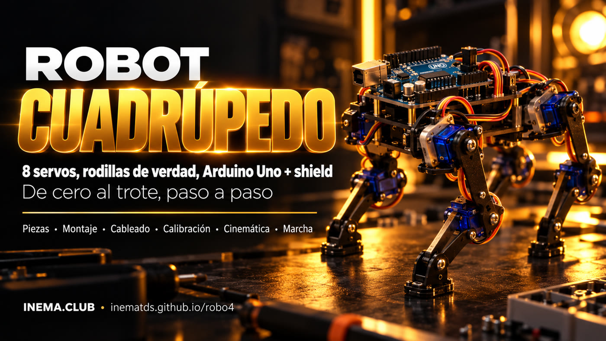

# robo4 — robot cuadrúpedo con rodillas

**🇧🇷 [Português](README.md) · 🇺🇸 [English](README.en.md) · 🇪🇸 [Español](README.es.md)**

## Qué es

robo4 es un plan completo para construir en casa un pequeño robot de cuatro patas (de unos 20 cm) que camina. Cada pata tiene dos servos: uno en la cadera y otro en la rodilla, 8 en total. Todo lo controla un Arduino Uno con un Sensor Shield V5 conectado encima, donde se enchufan los servos. El repositorio incluye la lista de piezas, los diagramas de cableado, el paso a paso de montaje y calibración, y el código que ya compila para el Uno.

## 📖 Guía de uso

Guía completa (página de presentación + paso a paso): **https://inematds.github.io/robo4/guia/es/**

Plan detallado (decisiones, piezas, pines, problemas comunes): [PLANO.md](PLANO.md) (en portugués)

## Qué hay aquí

| Ruta | Contenido |
|---|---|
| `PLANO.md` | Plan completo de construcción |
| `firmware/montagem/` | Sketch que pone los 8 servos en 90° para montar las patas |
| `firmware/robo4/` | Firmware: cinemática inversa, trote, marcha lenta, giro, calibración en la EEPROM |
| `guia/assets/diagrama-*.svg` | Diagramas: cableado, pines, geometría de la pata, calibración, marcha (PT, `-en`, `-es`) |
| `guia/assets/*.jpg` | Ilustraciones generadas por IA (kit, vista explotada, pata, cableado, robot montado) |
| `guia/` | Página de la guía en PT, `guia/en/` y `guia/es/` |

## Hardware en una línea

Arduino Uno + Sensor Shield V5 · 8× MG90S en los pines D2–D9 · LiPo 2S → UBEC 6 V/5 A en el bloque de terminales de los servos (jumper SEL fuera) · LiPo en VIN del Uno · GND común.

## El proceso, de principio a fin

Leyenda: 🧠 tú (con Nei) · ⚙️ comando/script · 🤖 `claude -p`

| # | Paso | Comando | Quién |
|---|---|---|---|
| 1 | Comprar las piezas de la lista y cargar la LiPo | [PLANO.md › Lista de piezas](PLANO.md#2-lista-de-peças) (en portugués) | 🧠 |
| 2 | Instalar el compilador del Uno | `arduino-cli core install arduino:avr && arduino-cli lib install Servo` | ⚙️ |
| 3 | Medir la salida del UBEC (5–6 V) antes de conectar un servo | multímetro | 🧠 |
| 4 | Conectar el Shield al Uno, quitar el jumper SEL, conectar el UBEC al bloque de terminales y la LiPo al VIN | [diagrama de cableado](guia/assets/diagrama-fiacao-es.svg) | 🧠 |
| 5 | Poner los 8 servos en 90° | `arduino-cli compile --fqbn arduino:avr:uno firmware/montagem && arduino-cli upload -p /dev/ttyACM0 --fqbn arduino:avr:uno firmware/montagem` | ⚙️ |
| 5b | Cortar o imprimir las piezas | [dibujo con medidas](guia/assets/diagrama-pecas-es.svg) | 🧠 |
| 6 | Montar los muslos en vertical y las espinillas en 90° | [diagrama de calibración](guia/assets/diagrama-calibracao-es.svg) | 🧠 |
| 7 | Cargar el firmware | `arduino-cli compile --fqbn arduino:avr:uno firmware/robo4 && arduino-cli upload -p /dev/ttyACM0 --fqbn arduino:avr:uno firmware/robo4` | ⚙️ |
| 8 | Calibrar desde el Monitor Serial (`m`, `o <perna> <junta> <graus>`, `p`, `g`) | `arduino-cli monitor -p /dev/ttyACM0 -c baudrate=9600` | 🧠 |
| 9 | Ponerlo de pie (`x`) y corregir `SENTIDO[][]` si alguna pata se dobla en el sentido equivocado | editar `firmware/robo4/robo4.ino` y repetir el paso 7 | 🧠 |
| 10 | Marcha lenta (`c`), luego trote (`w s a d`) | Monitor Serial | 🧠 |
| 11 | Actualizar la guía y los diagramas, y publicar | `git add -A && git commit && git push` (GitHub Pages mediante Actions) | 🧠 |

## Estado

El código compila para `arduino:avr:uno` (37% de la memoria de programa, 17% de la RAM). **Todavía no se ha probado en un robot montado**: las señales de los servos, las medidas L1/L2 y los tiempos de marcha son valores iniciales.

---

Hecho por [INEMA.CLUB](https://inema.club).